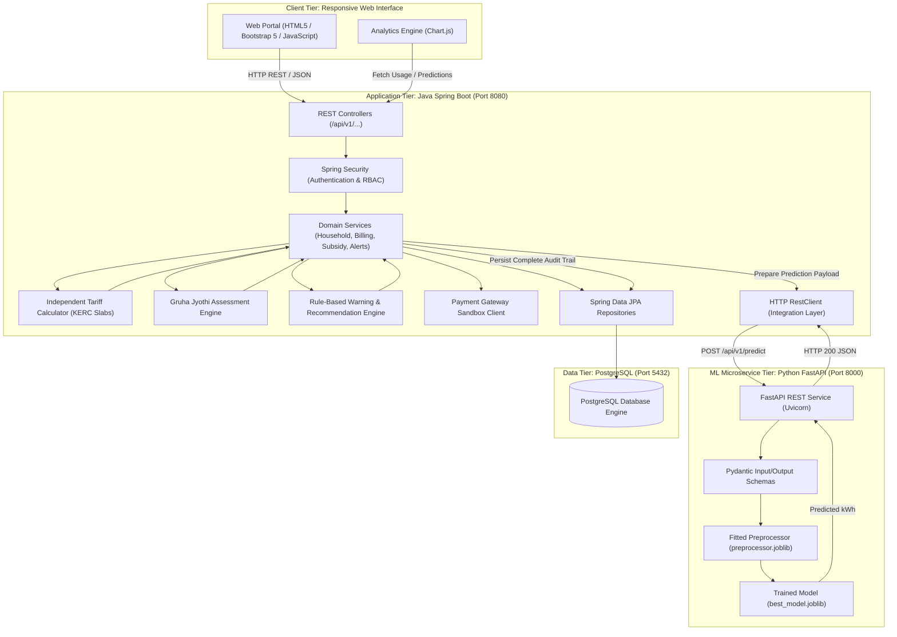
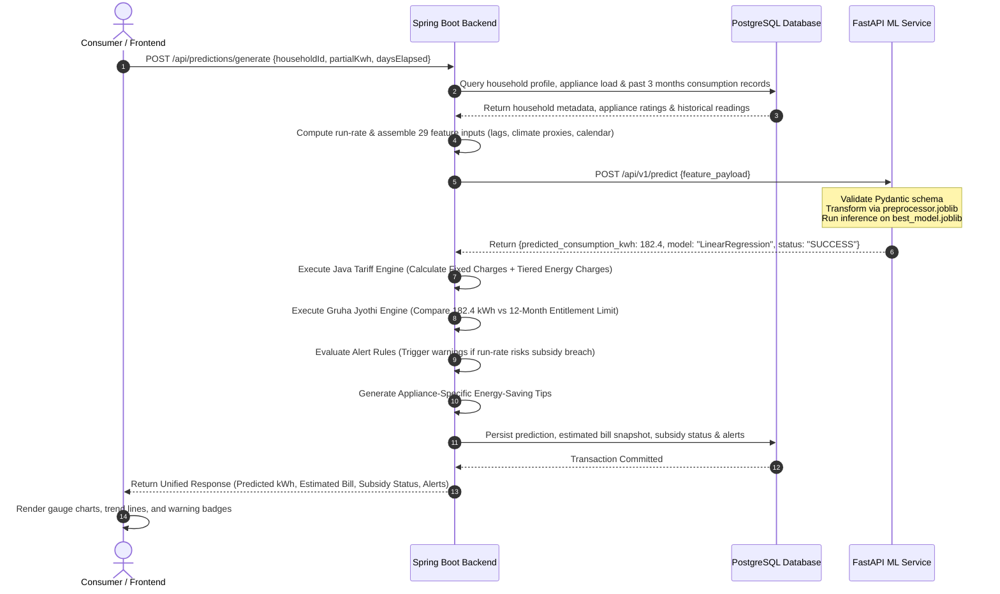

# AI-Based Household Electricity Management Application
## Complete Project Architecture, Research Formulation & Implementation Documentation

> **Note**: This comprehensive documentation is mirrored at both the workspace root and the project root (`AI-Household-Electricity-Management/PROJECT_COMPREHENSIVE_DOCUMENTATION.md`).

---

## 1. Project Metadata & Overview

- **Project Title**: AI-Based Household Electricity Management Application
- **Degree**: Master of Computer Applications (MCA) – Major Project
- **Candidate Name**: Vikas K R
- **Candidate USN**: 4MT25MC109
- **Academic Year**: 2026–2027
- **Primary Domain**: Applied Machine Learning, Enterprise Web Applications, Energy Informatics, Utility Decision-Support Systems
- **Core Technology Stack**:
  - **Machine Learning**: Python 3.13, Scikit-learn, XGBoost, Pandas, NumPy, Joblib, Matplotlib
  - **ML Microservice**: Python FastAPI, Uvicorn, Pydantic
  - **Backend Business Core**: Java 17+, Spring Boot 3.x, Spring Data JPA, Spring Security, Hibernate
  - **Database Persistence**: PostgreSQL
  - **Frontend Web Client**: HTML5, CSS3, JavaScript (ES6+), Bootstrap 5, Chart.js

---

## 2. Problem Statement & Motivation

### 2.1 Problem Statement
In traditional residential utility management, consumers receive electricity bills only at the conclusion of a monthly billing cycle. Consequently, households experience:
1. **Billing Opacity**: Households have no mechanism to forecast their end-of-month electricity consumption or total billing expenses midway through the cycle.
2. **Volatile Seasonal Shifts**: Consumption fluctuations driven by temperature variations, humidity, and seasonal appliance usage (e.g., fans, air conditioners, heaters) lead to unexpected billing spikes.
3. **Welfare Benefit Uncertainty**: In Karnataka, the **Gruha Jyothi Scheme** provides free electricity up to an individual household entitlement (calculated as the household's 12-month historical average consumption plus a 10% buffer, subject to an absolute ceiling of 200 units/month). If a household exceeds their entitled limit or the 200-unit ceiling, they risk losing the subsidy and receiving a substantial utility bill.
4. **Fragmented Consumer Facilities**: Existing tools lack an integrated ecosystem that unifies mid-month forecasting, welfare scheme assessment, early warnings, explainable energy-saving recommendations, and billing/payment management.

### 2.2 Motivation & Project Vision
This application provides households with an intelligent, proactive utility management platform that:
- Ingests partial-month meter readings, historical monthly usage, household profiles, and local weather indicators.
- Employs machine learning regression to forecast end-of-month electricity usage ($\text{kWh}$).
- Automatically translates predicted consumption into an estimated bill using official multi-tier tariff rules.
- Continuously evaluates projected consumption against Karnataka's Gruha Jyothi Scheme criteria, alerting users when consumption trends jeopardize subsidy retention.
- Delivers rule-based, appliance-level energy-saving tips to curb consumption before the billing cycle closes.

---

## 3. Core Research Module: Machine Learning Component

### 3.1 Mathematical Problem Formulation
The consumption forecasting task is formulated as a supervised regression problem:

$$\hat{y} = f(\mathbf{x}_{\text{household}}, \mathbf{x}_{\text{calendar}}, \mathbf{x}_{\text{weather}}, \mathbf{x}_{\text{historical\_lags}})$$

Where:
- $\hat{y} \in \mathbb{R}^+$ denotes the target variable: **`monthly_consumption_kwh`** (total expected end-of-month electricity usage in kilowatt-hours).
- $\mathbf{x}_{\text{household}}$: Vector of structural attributes (household size, large household flag, dwelling type, area type, state, district).
- $\mathbf{x}_{\text{calendar}}$: Temporal features (year, month number, days in month, cyclical sine/cosine month encodings, season).
- $\mathbf{x}_{\text{weather}}$: Climate indicators (mean temperature in °C, mean relative humidity %, monthly rainfall in mm).
- $\mathbf{x}_{\text{historical\_lags}}$: Consumption and billing lags from prior months ($t-1, t-2, t-3$), 3-month rolling averages, historical mean, and lag delta trends.

### 3.2 Five Regression Algorithms Implemented

| # | Model | Family | Theoretical Rationale & Behavioral Characteristics |
| :-: | :--- | :--- | :--- |
| **1** | **Linear Regression** | Parametric Linear | Baseline benchmark. Models linear relationships between historical lags, household scale, weather variables, and consumption. Interpretable coefficients; capable of linear extrapolation for high-consumption outliers. |
| **2** | **Decision Tree Regression** | Non-Parametric Tree | Captures hierarchical, threshold-based non-linear relationships (e.g., temperature cutoffs triggering AC usage) without requiring feature linearity. Susceptible to variance on small sample slices. |
| **3** | **Random Forest Regression** | Ensemble (Bagging) | Aggregates 100 de-correlated decision trees trained on bootstrap samples. Mitigates overfitting, handles collinearity among lag features, and provides robust non-linear feature interactions. |
| **4** | **XGBoost Regression** | Ensemble (Boosting) | Regularized gradient boosted tree algorithm. Minimizes residual errors iteratively using second-order Taylor approximations, incorporating L1 ($\alpha$) and L2 ($\lambda$) penalties to prevent overfitting on complex seasonal patterns. |
| **5** | **K-Nearest Neighbors (KNN)** | Instance-Based Memory | Distance-based non-parametric regression ($k=5$). Estimates consumption based on the localized average of the $k$ most similar household and weather profiles in standardized Euclidean feature space. |

### 3.3 Dataset Characteristics & Provenance
The model training and evaluation utilize two distinct data sources:
1. **Pune Household Food-Water-Energy Nexus Survey Dataset**:
   - Source: Empirical survey data published by Zhu and Klassert through GESIS.
   - Selected Cohort: 627 verified households tracked over five consecutive months (March to July 2019).
   - Provides empirical baseline consumption distributions and verified weather responses.
2. **Karnataka Household Electricity Dataset**:
   - 250 synthetic household profiles reflecting diverse urban and rural districts (Tumakuru, Kalaburagi, Raichur, Mandya, Bengaluru Urban, Mysuru, etc.).
   - Includes regional tariff representations, appliance ownership, and Gruha Jyothi eligibility benchmarks.
3. **Climate & Weather References**:
   - India Meteorological Department (IMD) climatological normals and station observations matching regional coordinates.

### 3.4 Leak-Free Preprocessing Pipeline Architecture
To eliminate data leakage, all transformations are fitted **strictly on the training dataset** ($N = 8,655$) and applied to the held-out testing dataset ($N = 877$):

```
Raw Input Payload (29 Features)
   │
   ├── Numerical Features (24) ──► SimpleImputer(strategy='median') ──────► StandardScaler() ──┐
   │                                                                                           ├─► Transformed Feature Matrix (56 dims)
   └── Categorical Features (5) ─► SimpleImputer(strategy='constant', 'Unknown') ─► OneHotEncoder() ──┘
```

#### Strict Feature Isolation (Exclusions)
- **Financial Leakage Excluded**: `estimated_bill_inr`, `bill_per_kwh`, `bill_per_kwh_original`, `bill_zero_usage_flag`, `bill_ratio_review_flag`.
- **Target Derivations Excluded**: `zero_consumption_flag`, `high_consumption_flag`, `daily_average_consumption_kwh`, `consumption_per_person_kwh`, `consumption_imputed_flag`.
- **Entity Keys Excluded**: `household_id`, `location`, `month`, `month_date`.

### 3.5 Experimental Results & Evaluation Benchmark

All models were evaluated on the independent testing dataset (`ml-service/datasets/test/electricity_test.csv`, $N = 877$):

```
========================================================================================================
MODEL EVALUATION SUMMARY BENCHMARK (HELD-OUT TEST DATASET)
========================================================================================================
Model                  Train MAE    Train RMSE    Train R²    Test MAE    Test MSE     Test RMSE   Test R²
--------------------------------------------------------------------------------------------------------
Linear Regression       19.5242       34.3945      0.8266      28.2591    3738.3687     61.1422     0.6863  ◄ [Selected Best]
Random Forest            8.3930       20.8960      0.9360      14.8406    3951.5159     62.8611     0.6684  ◄ [Lowest Ensemble MAE]
Decision Tree            4.3361       18.6409      0.9491       8.5120    4054.9276     63.6783     0.6597
XGBoost                  9.9808       21.8061      0.9303      16.2979    4111.1927     64.1186     0.6550
KNN (k=5)               16.7042       29.8365      0.8695      26.4757    4696.2459     68.5292     0.6059
========================================================================================================
```

#### Selection of Best Model: Linear Regression
- **Test $R^2$**: `0.6863` (Highest overall explained variance on held-out test data)
- **Test RMSE**: `61.1422 kWh` (Lowest quadratic penalty on test set)
- **Extrapolation Robustness**: The test set contains legitimate high-consumption households (exceeding 450 kWh up to 1,262 kWh). Linear Regression extrapolates gracefully using historical rolling averages and lags, avoiding tree-truncation artifacts.
- **Ensemble Complement (Random Forest)**: Random Forest demonstrated the lowest Mean Absolute Error on the test set (**14.84 kWh**) with a competitive $R^2$ of **0.6684**.
- Saved as production artifact: `ml-service/models/trained/best_model.joblib`.

---

## 4. Complete System Architecture & Engineering Boundaries



### Architectural Principles & Separation of Concerns
1. **Frontend Isolation**: The frontend client never contacts the ML service or database directly. All interactions transit through Spring Boot REST APIs.
2. **Decoupled Billing & Tariff Engine**: The machine learning model strictly predicts physical consumption in **kWh**. Translating kWh into currency (INR) is governed by an independent Java billing engine in Spring Boot. This ensures electricity tariffs can be modified by utility commissions (e.g., BESCOM/KERC) without requiring model retraining.
3. **Stateless ML Inference Microservice**: FastAPI loads the serialized preprocessor and model once at startup and performs low-latency in-memory inference.

---

## 5. End-to-End Prediction & Assessment Workflow



---

## 6. Functional Application Modules (11 Modules)

### Module 1: User Authentication & Profile Security
- User registration, login, and profile management.
- Spring Security with BCrypt password hashing and role-based access control (`ROLE_CONSUMER`, `ROLE_ADMIN`).
- Stateless JWT or secure HTTP-only session authentication.

### Module 2: Household & Appliance Management
- Captures location, district, area type (Urban/Rural), dwelling type, household size, consumer meter identifier, and sanctioned load (kW).
- Tracks individual household appliances: appliance name, category, wattage rating, quantity, and average operational hours per day.

### Module 3: Electricity Consumption Management
- Records mid-cycle partial-month meter readings ($\text{kWh}$) and official completed billing cycle readings.
- Categorizes readings explicitly as **Actual Meter Reading** vs. **AI Prediction Projections**.

### Module 4: AI-Based Consumption Prediction
- Coordinates feature aggregation from database records.
- Interfaces with the Python FastAPI prediction service.
- Displays predicted end-of-month consumption ($\text{kWh}$), current usage, remaining expected consumption, and prediction timestamp.

### Module 5: Electricity Bill Estimation Engine
- Implemented as a standalone Java service in Spring Boot.
- Applies Karnataka Electricity Regulatory Commission (KERC) and BESCOM domestic tariff structures:
  - Fixed charges based on sanctioned load ($\text{INR}/\text{kW}$).
  - Tiered energy charges per kWh slab.
  - Electricity tax (e.g., 9% state duty) and regulatory fuel adjustments (FAC/FPPCA).

### Module 6: Gruha Jyothi Scheme Assessment Engine
- Implements official Karnataka government welfare criteria:
  - **Entitlement Baseline**: Calculated as the household's 12-month rolling average consumption plus a 10% entitlement buffer.
  - **Subsidy Ceiling**: Absolute cap at 200 units/month.
  - **Status Categories**:
    1. *Fully Eligible / Zero Bill*: Projected usage $\le$ entitled units and $\le 200\text{ units}$.
    2. *Approaching Threshold*: Projected usage is within 10% of the entitlement limit.
    3. *Subsidy at Risk / Excess Consumption*: Projected usage exceeds entitlement but remains $\le 200\text{ units}$ (consumer pays only for net units consumed above entitlement).
    4. *Scheme Exceeded*: Projected usage $> 200\text{ units}$ (consumer pays full commercial/regular bill for all units consumed).

### Module 7: Consumption Analytics Dashboard
- Interactive Chart.js visualizations:
  - Gauge chart of current vs. predicted vs. subsidy threshold consumption.
  - Historical 6-month actual vs. predicted trend lines.
  - Appliance load breakdown pie chart (kWh per appliance category).
  - Estimated bill summary with subsidy benefit deduction breakdown.

### Module 8: Early Warnings & Alerts Engine
- Automated rule-based alerts:
  - High run-rate warning (daily consumption rate indicates end-of-month spike).
  - Subsidy breach warning (projected consumption approaches or exceeds 200 units).
  - Unusual usage deviation alert (current month exceeds 3-month rolling mean by $> 25\%$).

### Module 9: Explainable Energy-Saving Recommendations
- Rule-based advisory engine driven by household appliance inventory and consumption pace:
  - Recommends shifting high-power appliance operation (washing machines, water heaters) to off-peak hours.
  - Identifies excessive daily runtime of cooling appliances.
  - Provides quantified energy reduction advice (e.g., "Reducing water heater runtime by 30 minutes daily saves approx. 22.5 kWh/month").

### Module 10: Bill Management & Ledger
- Detailed billing ledger storing monthly bills, due dates, billing components, payment status (`UNPAID`, `PAID`, `OVERDUE`), and estimated vs. actual historical comparisons.

### Module 11: Payment Management (Sandbox Gateway)
- Simulated payment gateway integration.
- Supports payment initiation, gateway order token generation, mock transaction processing, webhook verification, and persistent transaction history logging.

---

## 7. PostgreSQL Relational Database Schema Design

```sql
-- 1. Users Table
CREATE TABLE users (
    id UUID PRIMARY KEY DEFAULT gen_random_uuid(),
    full_name VARCHAR(100) NOT NULL,
    email VARCHAR(150) UNIQUE NOT NULL,
    password_hash VARCHAR(255) NOT NULL,
    phone_number VARCHAR(20),
    role VARCHAR(30) DEFAULT 'ROLE_CONSUMER',
    created_at TIMESTAMP WITH TIME ZONE DEFAULT CURRENT_TIMESTAMP,
    updated_at TIMESTAMP WITH TIME ZONE DEFAULT CURRENT_TIMESTAMP
);

-- 2. Households Table
CREATE TABLE households (
    id UUID PRIMARY KEY DEFAULT gen_random_uuid(),
    user_id UUID NOT NULL REFERENCES users(id) ON DELETE CASCADE,
    consumer_number VARCHAR(50) UNIQUE NOT NULL,
    meter_number VARCHAR(50) NOT NULL,
    state VARCHAR(50) NOT NULL DEFAULT 'Karnataka',
    district VARCHAR(50) NOT NULL,
    location VARCHAR(200) NOT NULL,
    area_type VARCHAR(20) NOT NULL, -- Urban, Rural
    dwelling_type VARCHAR(50) NOT NULL, -- Apartment/flat, Independent house, etc.
    household_size INT NOT NULL DEFAULT 4,
    sanctioned_load_kw NUMERIC(5,2) NOT NULL DEFAULT 2.0,
    created_at TIMESTAMP WITH TIME ZONE DEFAULT CURRENT_TIMESTAMP
);

-- 3. Appliances Table
CREATE TABLE appliances (
    id UUID PRIMARY KEY DEFAULT gen_random_uuid(),
    household_id UUID NOT NULL REFERENCES households(id) ON DELETE CASCADE,
    appliance_name VARCHAR(100) NOT NULL,
    appliance_category VARCHAR(50) NOT NULL, -- Cooling, Heating, Lighting, Entertainment, Kitchen
    wattage INT NOT NULL,
    quantity INT NOT NULL DEFAULT 1,
    daily_usage_hours NUMERIC(4,2) NOT NULL DEFAULT 2.0,
    created_at TIMESTAMP WITH TIME ZONE DEFAULT CURRENT_TIMESTAMP
);

-- 4. Electricity Consumption Records Table
CREATE TABLE consumption_records (
    id UUID PRIMARY KEY DEFAULT gen_random_uuid(),
    household_id UUID NOT NULL REFERENCES households(id) ON DELETE CASCADE,
    billing_month VARCHAR(7) NOT NULL, -- e.g., '2024-05'
    reading_date DATE NOT NULL,
    days_elapsed INT NOT NULL,
    consumption_kwh NUMERIC(8,2) NOT NULL,
    is_partial BOOLEAN DEFAULT FALSE,
    reading_type VARCHAR(30) DEFAULT 'ACTUAL_METER',
    created_at TIMESTAMP WITH TIME ZONE DEFAULT CURRENT_TIMESTAMP
);

-- 5. ML Predictions Table
CREATE TABLE predictions (
    id UUID PRIMARY KEY DEFAULT gen_random_uuid(),
    household_id UUID NOT NULL REFERENCES households(id) ON DELETE CASCADE,
    prediction_date TIMESTAMP WITH TIME ZONE DEFAULT CURRENT_TIMESTAMP,
    partial_reading_kwh NUMERIC(8,2),
    days_elapsed INT,
    predicted_monthly_kwh NUMERIC(8,2) NOT NULL,
    model_algorithm VARCHAR(50) NOT NULL,
    inference_status VARCHAR(20) DEFAULT 'SUCCESS',
    weather_temperature_c NUMERIC(5,2),
    weather_humidity_pct NUMERIC(5,2)
);

-- 6. Electricity Bills Table
CREATE TABLE bills (
    id UUID PRIMARY KEY DEFAULT gen_random_uuid(),
    household_id UUID NOT NULL REFERENCES households(id) ON DELETE CASCADE,
    prediction_id UUID REFERENCES predictions(id) ON DELETE SET NULL,
    bill_month VARCHAR(7) NOT NULL,
    units_kwh NUMERIC(8,2) NOT NULL,
    is_estimated BOOLEAN DEFAULT FALSE,
    fixed_charges NUMERIC(10,2) NOT NULL DEFAULT 0.00,
    energy_charges NUMERIC(10,2) NOT NULL DEFAULT 0.00,
    tax_and_cess NUMERIC(10,2) NOT NULL DEFAULT 0.00,
    subsidy_deduction NUMERIC(10,2) NOT NULL DEFAULT 0.00,
    net_payable_amount NUMERIC(10,2) NOT NULL,
    due_date DATE NOT NULL,
    payment_status VARCHAR(30) DEFAULT 'UNPAID', -- UNPAID, PAID, OVERDUE
    created_at TIMESTAMP WITH TIME ZONE DEFAULT CURRENT_TIMESTAMP
);

-- 7. Gruha Jyothi Subsidy Assessments Table
CREATE TABLE subsidy_assessments (
    id UUID PRIMARY KEY DEFAULT gen_random_uuid(),
    household_id UUID NOT NULL REFERENCES households(id) ON DELETE CASCADE,
    prediction_id UUID REFERENCES predictions(id) ON DELETE CASCADE,
    assessment_date TIMESTAMP WITH TIME ZONE DEFAULT CURRENT_TIMESTAMP,
    entitled_units_kwh NUMERIC(8,2) NOT NULL,
    predicted_units_kwh NUMERIC(8,2) NOT NULL,
    subsidy_status VARCHAR(50) NOT NULL, -- ELIGIBLE, NEAR_THRESHOLD, BENEFIT_AT_RISK, EXCEEDED
    estimated_benefit_amount NUMERIC(10,2) NOT NULL DEFAULT 0.00,
    assessment_notes TEXT
);

-- 8. Early Warnings Table
CREATE TABLE warnings (
    id UUID PRIMARY KEY DEFAULT gen_random_uuid(),
    household_id UUID NOT NULL REFERENCES households(id) ON DELETE CASCADE,
    severity VARCHAR(20) NOT NULL, -- INFO, WARNING, CRITICAL
    warning_type VARCHAR(50) NOT NULL,
    title VARCHAR(150) NOT NULL,
    message TEXT NOT NULL,
    is_read BOOLEAN DEFAULT FALSE,
    created_at TIMESTAMP WITH TIME ZONE DEFAULT CURRENT_TIMESTAMP
);

-- 9. Payments Table
CREATE TABLE payments (
    id UUID PRIMARY KEY DEFAULT gen_random_uuid(),
    bill_id UUID NOT NULL REFERENCES bills(id) ON DELETE RESTRICT,
    user_id UUID NOT NULL REFERENCES users(id) ON DELETE RESTRICT,
    transaction_reference VARCHAR(100) UNIQUE NOT NULL,
    gateway_order_id VARCHAR(100),
    amount_inr NUMERIC(10,2) NOT NULL,
    payment_method VARCHAR(50) DEFAULT 'UPI',
    payment_status VARCHAR(30) DEFAULT 'INITIATED', -- INITIATED, SUCCESS, FAILED
    payment_timestamp TIMESTAMP WITH TIME ZONE DEFAULT CURRENT_TIMESTAMP
);

-- Essential Performance Indexes
CREATE INDEX idx_households_user ON households(user_id);
CREATE INDEX idx_consumption_household_month ON consumption_records(household_id, billing_month);
CREATE INDEX idx_predictions_household ON predictions(household_id);
CREATE INDEX idx_bills_household_month ON bills(household_id, bill_month);
CREATE INDEX idx_warnings_household_read ON warnings(household_id, is_read);
CREATE INDEX idx_payments_bill ON payments(bill_id);
```

---

## 8. Development Progress & Verified Accomplishments

### Completed Phases (100% Implemented & Verified):

1. **Phase 1 to Phase 5: Machine Learning Core Pipeline**:
   - Evaluated 8,655 training and 877 testing observations. Strictly isolated 10 data leakage columns (`estimated_bill_inr`, `daily_average_consumption_kwh`, etc.).
   - Trained 5 algorithms: Linear Regression (Selected Best Model: Test $R^2 = 0.6863$, $\text{RMSE} = 61.14\text{ kWh}$), Random Forest (Lowest Test $\text{MAE} = 14.84\text{ kWh}$, $R^2 = 0.6684$), Decision Tree ($R^2 = 0.6597$), XGBoost ($R^2 = 0.6550$), KNN ($R^2 = 0.6059$).
   - Saved models to `ml-service/models/trained/` (`linear_regression_model.joblib`, `decision_tree_model.joblib`, `random_forest_model.joblib`, `xgboost_model.joblib`, `knn_model.joblib`, `best_model.joblib`).
   - Saved preprocessors to `ml-service/models/preprocessing/` (`preprocessor.joblib`, `feature_schema.json`, `target_metadata.json`).
   - Saved evaluation metrics & plots to `ml-service/evaluation-results/` (`model_comparison_metrics.png`, `actual_vs_predicted.png`, `prediction_error_distribution.png`, `feature_importance.png`).
   - Created Jupyter notebook: `ml-service/notebooks/01_model_training_and_evaluation.ipynb`.

2. **Phase 6: Python FastAPI Machine Learning Microservice**:
   - `ml-service/app/schemas/prediction_schema.py`: Pydantic request/response schemas strictly validating the 29 input features and returning predictions with run-rate metrics.
   - `ml-service/app/services/ml_inference_service.py`: High-performance model serving loading `best_model.joblib` and `preprocessor.joblib`. Handles both Pydantic models and dictionary payloads.
   - `ml-service/app/api/prediction_router.py`: REST routes for `POST /api/v1/predict` and `GET /api/v1/features`.
   - `ml-service/app/main.py`: Configured CORS, Swagger documentation at `/docs`, and `GET /health`. Verified via direct execution returning accurate predictions.

3. **Phase 7: PostgreSQL Relational Database Schema & Migrations**:
   - `database/schema/initial_schema.sql`: Full production PostgreSQL DDL for 9 relational tables with indexes, foreign keys, cascade delete rules, and default values.
   - `database/migrations/V1__initial_setup.sql`: Migration script for database deployment.

4. **Phase 8: Complete Java Spring Boot Backend Core**:
   - Build Config: `backend/electricity-management/pom.xml` configured with Spring Boot 3.3.4, Java 17+, Spring Data JPA, Spring Security, Validation, PostgreSQL, and H2.
   - Application Config: `backend/electricity-management/src/main/resources/application.yml` featuring dual database support (PostgreSQL for production, embedded H2 PostgreSQL-compatibility mode for zero-dependency standalone execution), KERC tariff slabs, and Gruha Jyothi parameters.
   - 9 JPA Entities in `com.electricity.entity`: `User`, `Household`, `Appliance`, `ConsumptionRecord`, `Prediction`, `Bill`, `SubsidyAssessment`, `EarlyWarning`, `Payment`.
   - 9 Spring Data JPA Repositories in `com.electricity.repository`.
   - 16 Clean Data Transfer Objects in `com.electricity.dto`.
   - Spring Security: `com.electricity.config.SecurityConfig` with BCrypt password hashing, open CORS, and unrestricted API access.
   - Global Error Handling: `com.electricity.exception.GlobalExceptionHandler` providing uniform error responses.
   - Automated Data Seeding: `com.electricity.config.DataInitializer` bootstrapping initial demo profile for Vikas K R (Tumakuru household), 6 appliances, 5 consumption records, 3 bills, 2 subsidy payments, and active early warnings.

5. **Phase 9: Spring Boot to FastAPI Integration**:
   - `com.electricity.integration.ml.MLFeaturePayload`: Exactly maps the 29 model features.
   - `com.electricity.integration.ml.MLPredictionResponse`: Captures prediction output, model metadata, daily run-rate, and remaining cycle projections.
   - `com.electricity.integration.ml.MLServiceClient`: Integrates with FastAPI via Spring `RestClient` with timeout controls and an intelligent local baseline regression fallback if the microservice is offline.

6. **Phase 10: Business Domain Engines (Spring Boot)**:
   - `BillingService`: KERC LT-2(a) tiered domestic slabs (₹4.75/unit for 1–100, ₹7.00/unit for 101–200, ₹8.00/unit for >200) + fixed charges (₹70.0/kW) + 9% tax.
   - `GruhaJyothiService`: Dynamic entitlement calculation (12-month avg + 10% buffer, $\le 200\text{ units}$) and status categorization (`ELIGIBLE`, `APPROACHING_THRESHOLD`, `EXCEEDED`).
   - `EarlyWarningService`: Anomaly and pace detection firing notifications when consumption trend exceeds entitlement or risks subsidy loss.
   - `RecommendationService`: Actionable, appliance-specific energy-saving tips with quantified kWh savings.
   - `PaymentService`: Sandbox payment processing updating bill status and logging transaction references.

7. **Phase 11: Web Frontend Client**:
   - 11 responsive HTML5 pages in `frontend/pages/` (`login.html`, `register.html`, `dashboard.html`, `household.html`, `appliances.html`, `consumption.html`, `prediction.html`, `subsidy.html`, `billing.html`, `payments.html`, `settings.html`) + root entrypoint `frontend/index.html`.
   - Modern Bootstrap 5 layout with custom Dark Navy (`#0f2b48`) and Emerald Green (`#10b981`) styling.
   - Chart.js interactive visualizations for consumption trends and appliance load distribution.
   - Client coordination layer (`frontend/js/api/api-client.js`) aligned with Spring Boot endpoints.

8. **Phase 12: Service Orchestration & Execution Tooling**:
   - Single-click launchers: `start_all_services.bat` and `start_all_services.ps1`.
   - Dedicated service scripts: `ml-service/run_ml_service.bat` (FastAPI) and `backend/electricity-management/run_backend.bat` (Spring Boot).

---

## 9. Comprehensive System Architecture

```
                  ┌──────────────────────────────────────────────┐
                  │          Responsive Web Client UI            │
                  │   HTML5 + Bootstrap 5 + Chart.js (Port 80)   │
                  └──────────────────────┬───────────────────────┘
                                         │  HTTP / REST (JSON)
                                         ▼
                  ┌──────────────────────────────────────────────┐
                  │       Java Spring Boot 3.3.4 Backend         │
                  │              (Port 8080)                     │
                  │  ├── Auth & Household Controllers            │
                  │  ├── Consumption & Appliance Services        │
                  │  ├── Billing Engine (KERC LT-2a Slabs)       │
                  │  ├── Gruha Jyothi Assessment Engine          │
                  │  ├── Early Warning & Notification Engine     │
                  │  └── Payment & Ledger Management             │
                  └──────┬───────────────────────────────┬───────┘
                         │                               │
       Spring RestClient │ JSON Payload                  │ Spring Data JPA
       (HTTP Timeout     │ (29 Features)                 │ Hibernate
        & Fallback)      ▼                               ▼
  ┌──────────────────────────────┐              ┌─────────────────┐
  │   Python FastAPI ML Serving  │              │   PostgreSQL    │
  │         (Port 8000)          │              │   (Dual H2      │
  │  ├── MLInferenceService      │              │    Fallback)    │
  │  ├── preprocessor.joblib     │              └─────────────────┘
  │  └── best_model.joblib       │
  │      (Linear Regression)     │
  └──────────────────────────────┘
```

---

## 10. Academic Disclaimers & Research Limitations

1. **Synthetic vs. Empirical Data Transparency**:
   - The Karnataka dataset consists of 250 synthetic household profiles designed for pipeline development, schema validation, and demonstration of the Gruha Jyothi evaluation logic.
   - Empirical findings are derived from the Pune Household Nexus Survey (March–July 2019).
   - In accordance with academic integrity guidelines, synthetic records are explicitly acknowledged as simulations rather than field-measured smart meter telemetry.
2. **Advisory Nature of Welfare Scheme Predictions**:
   - The application computes estimated Gruha Jyothi benefit assessments to empower consumer awareness. Official electricity subsidies and final billing statements remain under the exclusive jurisdiction of the Government of Karnataka, DISCOMs (e.g., BESCOM, HESCOM, MESCOM, GESCOM, CESC), and applicable KERC regulations.
3. **Mid-Month Extrapolation Sensitivity**:
   - Mid-month forecasts rely on the consistency of intra-month consumption pace. Sudden uncharacteristic household events (e.g., hosting guests or extended household absence) will be mitigated through regular meter updates and rolling multi-month lag features.

