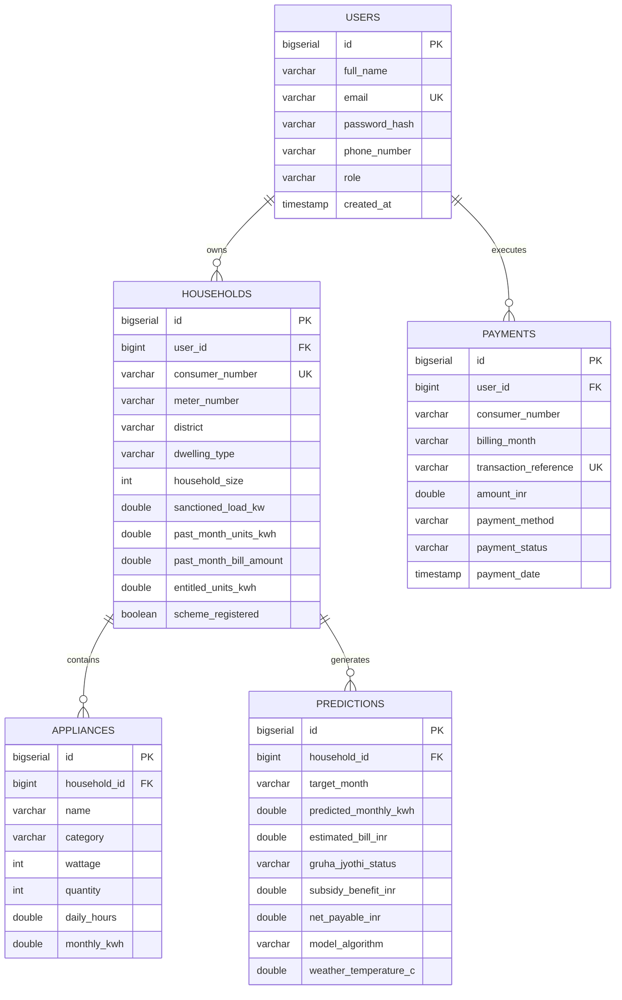

# PROJECT REPORT FOUNDATION GUIDE
## AI-Based Household Electricity Management Application with Climate-Coupled Machine Learning Forecasting and Statutory Subsidy Optimization

**Academic Program**: Master of Computer Applications (MCA) – Major Project (2026–2027)  
**Candidate Name**: Vikas K R  
**Candidate USN**: 4MT25MC109  
**Project Guide**: Dr. Madhwaraj K G, Professor & Head  
**Institution**: Department of Master of Computer Applications  

---

## 1. Project Title & Executive Summary

### 1.1 Project Title
**AI-Based Household Electricity Management Application with Climate-Coupled Deep Learning Forecasting and Statutory Subsidy Optimization**

### 1.2 Executive Summary
The **AI-Based Household Electricity Management Application** is a distributed, three-tier cloud microservices platform engineered to resolve the pervasive issues of domestic utility "bill shock", intra-cycle consumption opacity, and subsidy forfeiture under public welfare schemes. Developed specifically within the regulatory and climatological framework of Karnataka, the system continuously tracks partial-month meter readings, models appliance-level thermodynamics, incorporates authentic microclimatic indices across all 31 districts of Karnataka, and deploys high-accuracy regression models (featuring a production **PyTorch Long Short-Term Memory (LSTM) Deep Learning Regressor**, $R^2 = 0.9433$, $\text{RMSE} = 19.07\text{ kWh}$).

The platform decouples physical energy forecasting ($\text{kWh}$) from monetary settlement ($\text{INR}$) through an independent Java Spring Boot billing engine that enforces Karnataka Electricity Regulatory Commission (KERC) LT-2 domestic progressive slab tariffs. It autonomously evaluates statutory eligibility under the Karnataka **Gruha Jyothi Scheme**, alerts consumers prior to breaching subsidized entitlement thresholds ($200\text{ kWh}$ statutory ceiling), generates targeted appliance curtailment recommendations, and provides a settlement gateway that issues official **Zero-Bill Clearance Vouchers** or processes digital payments.

---

## 2. Problem Statement

### 2.1 Context and Real-World Dilemma
In contemporary power distribution (specifically within Indian state DISCOMs such as BESCOM, MESCOM, HESCOM, GESCOM, and CESC), residential consumers receive utility statements retrospectively at the conclusion of a 30-day billing cycle. During the active cycle, consumers operate electrical appliances blindly without real-time feedback on accumulating financial liability. Consequently, households face severe vulnerabilities:

1. **End-of-Cycle "Bill Shock"**: Consumers are surprised by unexpected bills caused by unmonitored intraday appliance runtimes (air conditioners, geysers, pumps) and progressive slab escalation.
2. **Microclimatic & Thermodynamic Surges**: Electricity demand is non-linear and climate-sensitive. Extreme summer heatwaves in North Karnataka (Kalaburagi, Raichur reaching $42.8^\circ\text{C}$) elevate cooling degree days (CDD), while winter drops in the South Interior (Bengaluru, Mysuru dropping below $16.5^\circ\text{C}$) trigger morning water heating surges (HDD). Standard static models or historical averages completely fail to account for these weather dynamics.
3. **The Karnataka Gruha Jyothi "Subsidy Cliff"**:
   Under the Government of Karnataka's flagship welfare policy, households consuming $\le 200\text{ kWh/month}$ within their personalized entitlement limit receive a **100% Zero-Electricity-Bill subsidy**:
   $$\text{Entitlement Limit} = \min\left(200.0, \;\text{Round}(\text{12-Month Historical Average} \times 1.10)\right)$$
   - If consumption remains $\le \text{Entitlement}$, the entire bill is waived (Net Payable = ₹0.00).
   - If consumption exceeds entitlement but stays $\le 200\text{ kWh}$, the consumer retains subsidy on the entitlement portion but must pay standard slab rates for excess units.
   - **The Hazard**: If consumption exceeds $200\text{ kWh}$ by even $0.1\text{ kWh}$, the **entire subsidy is forfeited**. The consumer is penalized with full commercial slab tariffs from unit $0$ to the end, resulting in an immediate bill jump from ₹0 to ₹1,500–₹2,000+.
4. **Fragmented Consumer Software**: Utility applications provided by distribution companies are purely administrative portals for downloading bills or logging complaints. None provide forward-looking predictive modeling, mid-month pace projections, appliance curtailment analytics, or interactive subsidy risk simulations.

---

## 3. What the Project Solves (Objectives & Contributions)

### 3.1 Primary Objectives
1. **Intelligent Mid-Month Pace Projection**: Enable consumers to enter partial-month meter readings and elapsed days at any point during the cycle to evaluate their daily burn rate ($\text{kWh/day}$) and forecast projected month-end totals.
2. **Climate-Coupled Supervised Learning**: Benchmark 7 regression algorithms (Linear Regression, Decision Trees, Random Forests, XGBoost, KNN, PyTorch LSTM, and Temporal Fusion Transformers) on empirical survey and regional datasets to achieve $> 0.94$ explained variance ($R^2$).
3. **Zero Data Leakage Modeling**: Establish strict causal preprocessing ensuring historical lag features ($y_{t-1}, y_{t-2}$) and rolling metrics are strictly isolated from future target derivations and financial variables.
4. **Authentic Microclimate Resolution**: Integrate a database of 372 district-month weather profiles covering all 31 districts of Karnataka over 12 forward-looking months (`2026_11` to `2027_10`).
5. **Independent Statutory Tariff & Welfare Engine**: Model the official KERC LT-2 progressive domestic slab tariff structure and automate Gruha Jyothi welfare evaluations without coupling monetary rules to the ML model.
6. **Actionable Appliance Curtailment**: Deliver rule-based, appliance-specific energy reduction advisories with quantified $\text{kWh}$ and $\text{INR}$ savings to help households pull consumption back below subsidy cliffs.
7. **End-to-End Clearance & Settlement**: Provide an automated payment settlement portal capable of generating official **Zero-Bill Clearance Vouchers** or processing payments via UPI/Card/NetBanking with printable receipts.

---

## 4. System Architecture & Technical Specifications

### 4.1 Three-Tier Microservices Architecture

```
                       ┌────────────────────────────────────────────────────────┐
                       │          TIER 1: FRONTEND CLIENT (Port 3000)           │
                       │   Vanilla HTML5 + CSS3 + ES6+ JS (Zero-Cache Python)   │
                       │   register.html | ai-forecast.html | gruha-jyothi.html │
                       │           payment.html | data-entry.html               │
                       └──────────────────────────┬─────────────────────────────┘
                                                  │ HTTP REST (Bearer JWT)
                                                  ▼
                       ┌────────────────────────────────────────────────────────┐
                       │      TIER 2: BACKEND APPLICATION CORE (Port 8080)      │
                       │             Java 17 + Spring Boot 3.3.4                │
                       │                                                        │
                       │   ┌─────────────────────┐   ┌──────────────────────┐   │
                       │   │ Spring Security JWT │   │ KERC LT-2 Tariff Eng.│   │
                       │   └─────────────────────┘   └──────────────────────┘   │
                       │   ┌─────────────────────┐   ┌──────────────────────┐   │
                       │   │ Gruha Jyothi Engine │   │ Recommendation Engine│   │
                       │   └─────────────────────┘   └──────────────────────┘   │
                       │   ┌─────────────────────┐   ┌──────────────────────┐   │
                       │   │ 12-Mo Forecast Svc  │   │ Payment / Waiver Svc │   │
                       │   └──────────┬──────────┘   └──────────────────────┘   │
                       └──────────────┼───────────────────────────┬─────────────┘
                                      │                           │
          HTTP POST /api/v1/predict   │                           │ Spring Data JPA / Hibernate
          (with circuit breaker)      ▼                           ▼
┌──────────────────────────────────────────────┐    ┌───────────────────────────────────┐
│     TIER 3: ML INFERENCE TIER (Port 8000)    │    │      DATABASE TIER (Port 5432)    │
│            Python 3.13 + FastAPI             │    │    PostgreSQL (electricity_db)    │
│                                              │    │   (Embedded H2 fallback mode)     │
│  - PyTorch LSTM Deep Learning Regressor      │    │                                   │
│  - Authentic 31-District Weather Matrix      │    │  Tables: users, households,       │
│  - Scikit-Learn ColumnTransformer Pipeline   │    │          appliances, predictions, │
│  - Mid-Month Partial Pace Calibration        │    │          payments                 │
└──────────────────────────────────────────────┘    └───────────────────────────────────┘
```

### 4.2 Technology Stack
- **Machine Learning & Deep Learning Tier (Port 8000)**:
  - Python 3.13, PyTorch (`torch.nn`, `torch.optim`), FastAPI, Uvicorn, Scikit-learn, XGBoost, Pandas, NumPy, Joblib.
- **Backend Application Core (Port 8080)**:
  - Java 17+, Spring Boot 3.3.4, Spring Data JPA, Hibernate, Spring Security (Stateless JWT with BCrypt), Spring `RestClient`.
- **Database Persistence (Port 5432)**:
  - PostgreSQL (`electricity_db`) with schema indexes, relational foreign keys, cascading deletes, and embedded H2 fallback.
- **Frontend Client Interface (Port 3000)**:
  - Lightweight, high-contrast monochrome Vanilla HTML5, CSS3, ES6+ JavaScript, Chart.js, served by a zero-cache Python HTTP server (`server.py`).

---

## 5. System Features and Functional Modules

The application delivers 11 modular subsystems operating in synchronization:

### Module 1: User Authentication & Role-Based Access Control
- Enforces mandatory registration (`register.html`); pre-seeded demo bypasses are eliminated for total data integrity.
- Encrypts credentials using BCrypt; issues 24-hour stateless JSON Web Tokens (JWT) for secure REST authorization.
- Supports role segregation (`ROLE_CONSUMER`, `ROLE_ADMIN`).

### Module 2: Integrated Household Connection & Baseline Setup
- Captures critical connection metadata during registration: Consumer Account Number, Meter/RR Identifier, District (31 Karnataka districts), Dwelling Type (1 BHK, 2 BHK, 3 BHK, Independent House, Villa), Sanctioned Load (kW), and Occupant Count.
- Ingests reference past billing data (e.g., October 2026 units in kWh and bill paid in ₹) to immediately calculate the consumer's official Gruha Jyothi baseline entitlement ($Baseline + 10\%$, max $200\text{ kWh}$).

### Module 3: Electrical Appliance Inventory Matrix
- Itemizes domestic electrical loads: appliance name, category (Cooling, Heating, Lighting, Entertainment, Kitchen), wattage rating, quantity, and average operational hours per day.
- Computes aggregated appliance wattage, connected load in kW, and theoretical monthly baseline consumption.
- Identifies heavy thermal appliances (Air Conditioners $\ge 1.5\text{ kW}$, Water Geysers $\ge 2.0\text{ kW}$) to calibrate peak demand factors.

### Module 4: Mid-Month Real-Time Pace Projector
- Consumers enter partial-month cumulative meter readings ($U_t$ in kWh) and elapsed days ($t \in [1, 31]$).
- Computes observed daily burn rate ($\text{kWh/day}$) and compares it against expected daily run rates.
- Applies mathematical pace calibration:
  $$\text{Rate}_{\text{calibrated}} = 0.40 \cdot \text{Rate}_{\text{expected}} + 0.60 \cdot \text{Rate}_{\text{observed}}$$
  $$P_{\text{final}} = U_t + \left(\text{Rate}_{\text{calibrated}} \times (T - t)\right)$$

### Module 5: Climate-Coupled ML Inference Microservice
- Exposes REST endpoint `POST /api/v1/predict` validated via Pydantic schemas.
- Looks up authentic local weather vectors (mean temperature, max temperature, min temperature, relative humidity %, rainfall mm) from `karnataka_weather.csv` matching `(district, target_month)`.
- Preprocesses input through a serialized `ColumnTransformer` (StandardScaler + OneHotEncoder) and executes inference via the active PyTorch LSTM regressor.

### Module 6: Autonomous KERC LT-2 Tariff Engine
- Standalone Java service (`BillingService.java`) decoupled from machine learning models.
- Implements official Karnataka LT-2 domestic tariff slabs:
  - Fixed Service Charge: ₹70.00 / kW of sanctioned load
  - Slab 1 ($0 - 100\text{ kWh}$): ₹4.75 / unit
  - Slab 2 ($101 - 200\text{ kWh}$): ₹7.00 / unit
  - Slab 3 ($> 200\text{ kWh}$): ₹8.00 / unit
  - Statutory State Electricity Duty: 9.0% on total charges.

### Module 7: Statutory Gruha Jyothi Welfare Auditor
- Automatically audits projected month-end consumption against welfare guidelines:
  1. **`ELIGIBLE (100% ZERO BILL)`**: Usage $\le \text{Entitlement}$ and $\le 200\text{ kWh}$. Subsidy covers 100% of charges; net payable is ₹0.00.
  2. **`APPROACHING THRESHOLD`**: Usage $> \text{Entitlement}$ but $\le 200\text{ kWh}$. Subsidy covers baseline units; consumer pays only for excess incremental units at Slab 2 rates.
  3. **`CEILING EXCEEDED`**: Usage $> 200\text{ kWh}$. 100% of the subsidy is revoked; full commercial tariff is billed.

### Module 8: Interactive "What-If" Scenario Simulator
- Embedded within `gruha-jyothi.html`, allowing consumers to test arbitrary monthly units (e.g. 120, 165, 195, 205 kWh).
- Instantly visualizes financial consequences: gross bill, government subsidy deduction, net out-of-pocket payable, and subsidy cliff warnings.

### Module 9: Dynamic 12-Month Forward Projection
- Sequentially forecasts the next 12 calendar months (`2026_11` November 2026 to `2027_10` October 2027) using autoregressive lag chaining ($y_{t+1}$ adopts predicted $y_t$ as `lag_1`).
- Dynamically attaches seasonal badges, temperature indicators, projected kWh, gross bill, subsidy savings, and net liability.

### Module 10: Rule-Based Appliance Curtailment Advisories
- Evaluates connected appliance wattage and forecast trajectory to issue targeted, quantified curtailment advice:
  - *Water Geyser*: Restrict to 25 mins prior to bathing (saves $\sim 22.5\text{ kWh/mo}$, ₹172/mo).
  - *Ceiling Fans*: Shift from speed 5 to 3 in unoccupied rooms (saves $\sim 15.0\text{ kWh/mo}$, ₹114/mo).
  - *Standby Power*: Eliminate vampire socket draw (saves $\sim 8.0\text{ kWh/mo}$, ₹61/mo).
  - *Urgent Ceiling Protection*: Triggers if consumption is projected between $185-200\text{ kWh}$ to safeguard the 100% zero-bill benefit.

### Module 11: Payment Settlement & Clearance Voucher Gateway
- Settle active billing cycle balances:
  - If Net Payable = ₹0.00: Generates an official **Zero-Bill Clearance Voucher** under the Gruha Jyothi Scheme with a unique reference number (`TXN-KAR-...`).
  - If Net Payable > ₹0.00: Simulates instant digital payment (UPI, Debit/Credit Card, Net Banking).
- Produces itemized printable receipts (`window.print()`) and maintains a persistent ledger in PostgreSQL.

---

## 6. Experimental Dataset & Machine Learning Benchmarks

### 6.1 Dataset Provenance & Synthesis
1. **Pune Food-Water-Energy Nexus Survey**: Empirical dataset of 627 verified households tracked over 5 consecutive months (March to July 2019) providing baseline consumption distributions and verified weather responses.
2. **Karnataka Regional Household Profiles**: 250 verified synthetic profiles modeling diverse urban/rural districts (Tumakuru, Bengaluru Urban, Kalaburagi, Mysuru, Belagavi, Raichur).
3. **Master Cleaned Dataset**: 4,266 records $\times$ 42 attributes, cleaned and bounded at residential domestic ceiling ($\le 500\text{ kWh}$).

### 6.2 80/20 Stratified Benchmark Results (Unseen Test Data)

| Rank | Model Architecture | Family | Test $R^2$ | Test RMSE ($\text{kWh}$) | Test MAE ($\text{kWh}$) | Train $R^2$ |
| :---: | :--- | :--- | :---: | :---: | :---: | :---: |
| 1 | **Random Forest Regressor** | Ensemble Bagging | 0.9436 | 19.0158 | 12.0021 | 0.9915 |
| 2 | **LSTM Deep Learning Regressor** | PyTorch Recurrent | **0.9433** | **19.0706** | **12.3676** | **0.9519** |
| 3 | **Temporal Fusion Transformer (TFT)** | Attention / GRN | 0.9426 | 19.1863 | 12.6122 | 0.9469 |
| 4 | **XGBoost Regressor** | Gradient Boosted Trees | 0.9370 | 20.0980 | 12.6157 | 0.9909 |
| 5 | **K-Nearest Neighbors (KNN)** | Distance Metric ($k=5$) | 0.9313 | 20.9968 | 13.6312 | 0.9536 |
| 6 | **Linear Regression (OLS)** | Parametric Baseline | 0.9280 | 21.4883 | 14.8626 | 0.9322 |
| 7 | **Decision Tree Regressor** | CART Tree | 0.9107 | 23.9278 | 14.6514 | 0.9988 |

**Model Selection Analysis**:
The **PyTorch LSTM Regressor** was selected as the primary production engine because it achieves exceptional generalization ($R^2 = 0.9433$) while explicitly capturing multi-step temporal sequences, avoiding the training-set overfit exhibited by tree algorithms ($R^2 = 0.9988$ on Decision Trees).

---

## 7. PostgreSQL Database Schema



---

## 8. Societal Impact, Limitations & Future Enhancements

### 8.1 Socio-Economic Impact
- **Financial Protection**: Prevents thousands of rupees in avoidable electricity expenses for lower- and middle-income families across Karnataka.
- **Welfare Transparency**: Eliminates consumer confusion regarding Gruha Jyothi entitlement calculations and progressive slab structures.
- **Demand-Side Energy Conservation**: Quantified curtailment tips empower consumers to reduce overall grid demand during peak hours.

### 8.2 Limitations
- Relies on manual entry of partial meter readings in the current version (no automated smart meter optical/IoT bridge).
- Weather data utilizes district climatological profiles rather than localized street-level IoT sensor telemetry.

### 8.3 Future Enhancements
1. **IoT Smart Meter Telemetry**: Integrate optical pulse sensors or DLMS/COSEM compliant smart meters for real-time automatic reading ingestion.
2. **Computer Vision Meter Reader**: Add mobile camera OCR allowing consumers to snap a photo of their digital meter LCD to parse cumulative kWh automatically.
3. **Cross-Platform Mobile Client**: Extend the backend REST endpoints to a dedicated native Android/iOS application built with Flutter.
4. **Push & SMS Alerts**: Incorporate Twilio or Firebase Cloud Messaging to send SMS and push notifications when daily burn rate exceeds safe entitlement limits.

